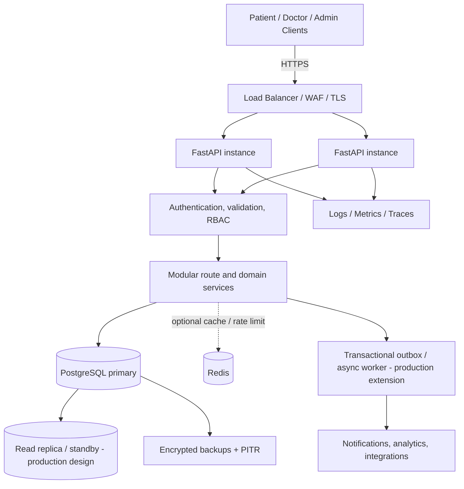
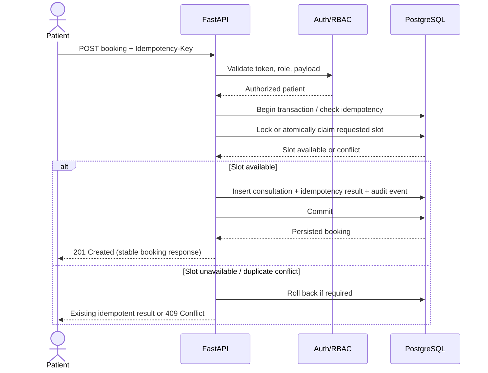
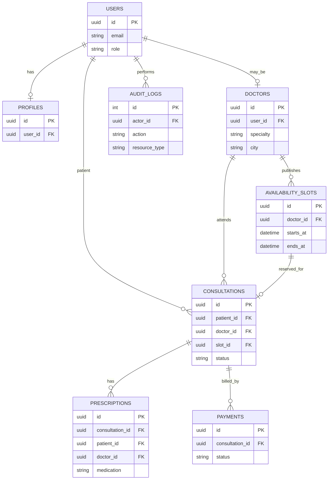

# Amrutam Telemedicine Backend — Architecture

**Status:** Design document for the current project and its proposed production deployment. Proposed high-availability controls are not proof that they are deployed.

## 1. Goals and constraints

The system supports patient/doctor identity, doctor availability, consultation booking and lifecycle transitions, prescriptions, payments/audit-related data, and administrative operations. The assignment targets 100,000 consultations/day, read p95 <200 ms, write p95 <500 ms, and 99.95% availability.

At 100,000 consultations/day, the daily average is about 1.16 consultation events/second. Capacity must be planned for peak-hour and burst traffic, retries, search traffic, and background work—not just the daily average. The latency and availability goals must be measured under representative load.

## 2. High-level architecture and data flow

**Current code shape:** a modular Python/FastAPI application, async SQLAlchemy sessions, Pydantic schemas, PostgreSQL, Alembic migrations, optional Redis configuration, tests, Docker configuration, and a GitHub Actions workflow.

**Production deployment direction:** stateless API replicas behind a managed load balancer; managed PostgreSQL with multi-zone failover, backups and point-in-time recovery; Redis only for cache/rate-limiting where consistency permits; a durable queue/outbox worker for slow external work; centralized telemetry; and secrets from a managed secret store.

## 3. Booking flow sequence

### Concurrency invariants

- A slot must not be booked by two consultations at the same time.
- The database, not a cache, is the final authority for slot ownership.
- Enforce uniqueness/locking at the database boundary; return a conflict when another transaction wins.
- Repeated requests with the same idempotency key and same effective payload should return the saved result. A key reused for a different payload should be rejected.
- Persist the booking and idempotency result atomically. Do not make external network calls while holding a database transaction open.

## 4. Core data model (logical ER diagram)

The diagram is logical. Confirm exact column names, constraints, and cardinalities against `app/models/` and the Alembic migration before treating it as a database migration specification.

## 5. API schema and modular boundaries

FastAPI exposes OpenAPI dynamically at `/openapi.json` and interactive Swagger UI at `/docs`. Registered route functions and Pydantic request/response models are the source of truth. Main API domains include authentication/users, doctors/availability, consultations/bookings, prescriptions, payments, and administrative functions. Check the running OpenAPI document for exact paths, request fields, response codes, and security requirements.

Suggested module boundaries:
- **Identity:** login, token lifecycle, roles, account/profile data.
- **Discovery:** doctor profile, specialty/city filters, availability queries.
- **Booking/consultation:** slot claim, idempotency, state machine, cancellation.
- **Clinical records:** prescription creation and authorized retrieval.
- **Payments:** provider integration, webhook verification, reconciliation.
- **Audit/analytics:** security and business events, aggregate reporting.
- **Platform:** config, DB session lifecycle, rate limiting, metrics and logging.

Keep HTTP handlers thin. Put business invariants in service functions and enforce data invariants with database constraints.

## 6. Transactions, retries, and sagas

### Database transactions
- Keep a transaction short and limited to database work.
- Use a single transaction for booking, slot claim, idempotency record, and the corresponding audit/outbox record where implemented.
- Avoid nested `begin()` calls on a session that already has a transaction. Establish a clear session/transaction ownership policy and test it.
- Use optimistic version checks or row-level locking for state transitions.
- Never blindly retry a non-idempotent write after a timeout; first resolve the idempotency key or read the operation state.

### Retry and backoff
- Retry transient network/serialization failures only, with capped exponential backoff and jitter (for example, base 100 ms, multiplier 2, cap 2–5 seconds, small bounded attempt count).
- Do not retry validation errors, permission errors, or business conflicts.
- For external payment/notification calls, use provider idempotency keys and bounded retries; route persistent failures to a dead-letter/manual reconciliation workflow.
- Respect `Retry-After` when a dependency provides it.
- Set connect/read/overall timeouts. A retry policy without timeouts can amplify outages.

### Sagas and outbox
A payment or notification workflow spans systems and cannot be made atomic with a PostgreSQL transaction alone. Persist the business change and an outbox event together, publish asynchronously, and make consumers idempotent. Model compensations explicitly (for example, payment reversal or booking cancellation) and reconcile eventual states. Treat this as a production extension unless the corresponding worker/outbox integration is verified in code.

## 7. Caching and search

- Cache only data that can tolerate bounded staleness (e.g. public doctor profile/search results).
- Do not use cached availability as the final booking authority.
- Use short TTLs, explicit invalidation after profile/slot changes, and metrics for hit rate and stale results.
- Search filters should be validated and backed by appropriate indexes; avoid unbounded page sizes.
- Redis failure should have a documented fallback. Do not silently bypass security rate limits if doing so would expose the API to abuse.

## 8. Data partitioning and scaling

Start with a properly indexed PostgreSQL schema and query-plan measurements. Do not partition prematurely. At higher volume:
1. Index consultation access patterns (patient, doctor, status, created/starts-at timestamps) and foreign keys.
2. Archive or partition high-volume append-only audit/event tables by time after validating retention and query requirements.
3. Consider time-based partitioning for consultations only if table size/query patterns justify it; unique constraints and foreign-key design must be checked carefully.
4. Use read replicas only for queries that tolerate replication lag; route writes and read-after-write flows to the primary.
5. Scale API horizontally; keep sessions and business state out of process memory.
6. Apply connection-pool limits across all replicas so total connections stay within database capacity.

## 9. Availability, backup, and disaster recovery

Proposed production baseline:
- Multi-zone application replicas and managed PostgreSQL with automated failover.
- Encrypted automated backups plus point-in-time recovery (PITR); separately protect backup access.
- Define business-approved RPO/RTO before selecting retention and replication settings.
- Example starting objectives to validate with stakeholders: RPO <= 5 minutes, RTO <= 60 minutes.
- Run restore drills, failover exercises, and verify schema migrations are compatible with rollback/roll-forward plans.
- Document regional disaster recovery, DNS/traffic cutover, credentials, and post-recovery reconciliation.
- Keep backups in a separate account/project or equivalent trust boundary where feasible.

These are recommendations, not evidence that multi-zone deployment, PITR, or restore drills currently exist.

## 10. Performance and SLO validation

- Use realistic load tests with bursty booking and search workloads, not only average throughput.
- Measure p50/p95/p99 latency, error rate, saturation, DB pool wait, query time, lock waits, cache hit rate, and queue lag.
- Profile slow queries and run `EXPLAIN (ANALYZE, BUFFERS)` on representative data.
- Define SLOs and error-budget alerts; 99.95% monthly availability allows about 21.6 minutes of downtime in a 30-day month.
- Do not claim targets are met until results are collected from a production-like deployment and retained as evidence.
